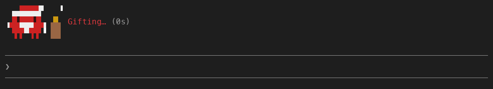
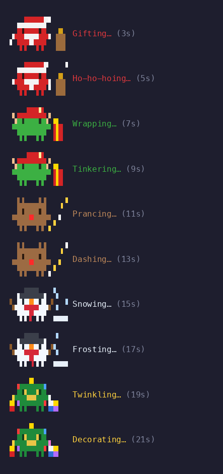
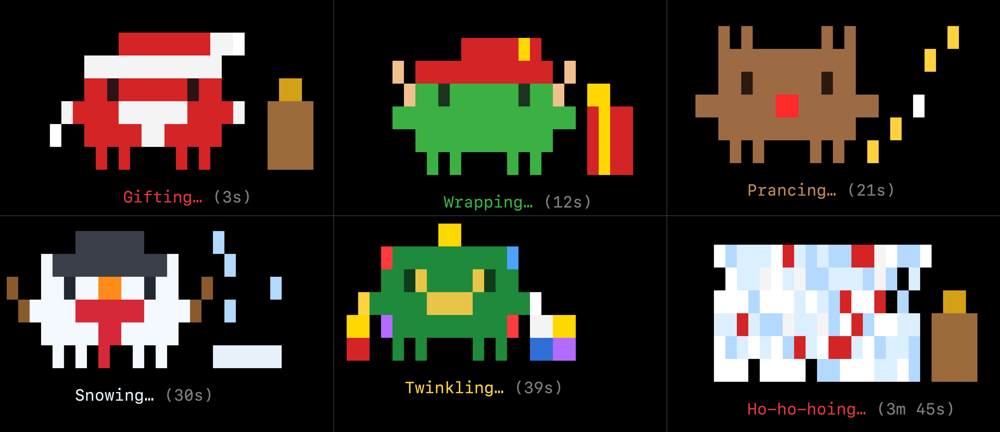

# christmas

A Claude Code mod that decks the spinner. While Claude works, a small
animated Clawd (the size of the welcome screen mascot, 3 rows by 12 columns)
takes the spinner's place and cycles through five Christmas costumes, nine
seconds each, swapping in a puff of snow:

| Costume | Effects | Spinner words |
| --- | --- | --- |
| Santa Clawd | red with a white-trimmed hat and pom-pom, a beard, a sack, falling snow | Gifting, Ho-ho-hoing, Delivering, Chimneying |
| Elf Clawd | green with a pointy hat, pointed ears, a jingling bell, a wrapped present | Wrapping, Tinkering, Jingling, Toymaking |
| Reindeer Clawd | brown with antlers and a blinking red nose, a sleigh trail of stars | Prancing, Dashing, Galloping, Sleighing |
| Snowman Clawd | white with a carrot nose, coal eyes, a top hat, a scarf that flaps, snowflakes | Snowing, Frosting, Flurrying, Chilling |
| Tree Clawd | green with a gold star on top, twinkling multicolor baubles, garland, gifts underneath | Twinkling, Decorating, Glittering, Shining |

The word beside him comes from his costume, so it changes with every costume
swap, and each costume moves on to its next word every time it comes around.
Nothing else on screen changes, and he is gone the moment the turn ends.





He also comes as a bigger macOS [screensaver](#screensaver).

## Install

```
/plugin install christmas --marketplace https://themes.whirlwin.io/marketplace.json
```

Answer `y` to add the marketplace, then pick a scope.

## Update

`/plugin update` installs from the local clone of the marketplace and does
not fetch it first, so refresh the clone before updating:

```
claude plugin marketplace update claude-themes
claude plugin update christmas@claude-themes
```

Then run `/reload-plugins` in an open session, or restart Claude Code.

## Use

| Command | What it does |
| --- | --- |
| `/christmas` | hide Clawd, or bring him back |
| `/christmas next` | skip straight to the next costume |

## Screensaver

The same five costumes also come as a macOS screensaver, big enough to fill
the screen. It plays the mod's own frames, baked from `hooks/scene.ts` at
build time. Each quadrant pixel is drawn as a block twice as tall as it is
wide, like a terminal cell, so Clawd keeps his shape. Below him are the
costume's word and how long the screensaver has been running. He moves to a
new spot with every costume swap, behind the puff of snow, so nothing burns
in.



Building needs macOS 13 or later, the Xcode command line tools and Node 22.18
or later (to run `scene.ts` without a compile step):

```
screensaver/build.sh --install
```

This builds `screensaver/build/Christmas Clawd.saver` and copies it into
`~/Library/Screen Savers`. Then pick Christmas Clawd in System Settings,
Screen Saver. Leave out `--install` to only build it.

`screensaver/render.swift` loads a built saver the way macOS does and renders
frames offscreen into one PNG. The build uses it for the thumbnails System
Settings shows, and it drew the picture above:

```
swift screensaver/render.swift "screensaver/build/Christmas Clawd.saver" docs/screensaver.png 756 491 20 85 140 200 260 1500
```

## How it works

Mods can only draw where Claude Code exposes a render site, and the welcome
screen logo is not one of them (as of Claude Code 2.1.296), so Clawd moves
into the spinner instead. He is a `Raster` of quadrant block glyphs traced
from the welcome screen, repainted with `$.ui.blit` on a 150 ms clock rather
than redrawing the whole tree.

A terminal cell shows two colors, and only one where part of it is left
empty, so each costume puts its details (trim, beard, ears, nose, baubles)
in cells that can hold them. Snow, stars and sparkles are only drawn into a
cell that can still show them, so they slip behind Clawd instead of knocking
a pixel out of him, and the screensaver shows exactly what the spinner does.

Drawing a tree in the spinner's place drops what the engine draws after the
word (elapsed time, tokens, effort), so the mod shows its own elapsed time.
The token count is not shown. In the desktop app only the word changes.

## Develop

From `plugins/christmas`:

```
claude --plugin-dir .
claude plugin validate .
claude plugin test .
```

## License

MIT, see [LICENSE](LICENSE).
