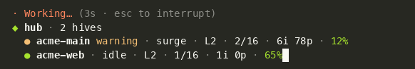

# hive

A Claude Code mod that shows every [Hive Commons](https://github.com/hivecommons/hive)
hive running on your machine. While Claude works, each hive gets one line under
the spinner: health, governor mode, agents up, open issues and PRs, and how
much of the token budget is spent.



```
◆ hub · 2 hives
  ● acme-main warning · surge · 2/16 1 busy · 6i 78p · 12%
  ● acme-web · idle · 1/16 · 1i 0p · 65%
```

`/hive` opens a pane with two lines per hive: the same line plus the next
governor kick, burn rate, cost this week and port, then the running agents,
each repo with its issues, PRs, ready (↑) and held (⏸) work, and any health
check that is not passing. The pane also opens by itself while a conversation
is still empty, and closes at your next prompt.

A toast and a status line entry say when a hive stops answering, a health
check fails or a budget runs out. Each toasts once until it clears. Warnings
show in the pane only.

A local hub (a container with the compose service `hub`) is found too. When
there is one, its line comes first, `◆ hub · 2 hives · :3021` (the port in the
pane only), and the hives that report to it sit under it, indented by two
spaces; in the pane each hive's second line moves in with it. Hives with no
local hub (hub disabled, a remote hub, or no hub running) follow at the top
level, as they do when there is no hub at all.

The count is the hives listed under the hub, `no hives` when there are none.
The hub's own registry hides private hives, so it only tells the mod whether
the hub is up. A hive belongs to a hub when its `/api/health/deep` has a
`hub_heartbeat` check and the `hub_url` in its `/api/config` names a local
host (`localhost`, `127.0.0.1`, `host.containers.internal` or
`host.docker.internal`) and the port the hub publishes. A hive whose heartbeat
is not accepted gets a dim yellow `hb⚠` on its line (with the reason, if any,
in the pane) and a toast once. A hub that stops answering toasts like a hive.

## How it finds hives

It asks podman every 15 seconds. A hive is any container from the
`hivecommons/hive` image; its port is the one the gateway in the same compose
project publishes. Start another hive with its own compose project and it
shows up; stop one and it turns red. Each hive's dashboard token is read from
its container's environment with `podman inspect`, kept in memory only, and
sent to that hive alone, on `127.0.0.1`.

It needs `podman` on your `PATH` (or at `/opt/homebrew/bin/podman`) and hives
started with Compose, which labels the containers.

## Install

```
/plugin install hive --marketplace https://themes.whirlwin.io/marketplace.json
```

Answer `y` to add the marketplace, then pick a scope.

## Update

`/plugin update` installs from the local clone of the marketplace and does
not fetch it first, so refresh the clone before updating:

```
claude plugin marketplace update claude-themes
claude plugin update hive@claude-themes
```

## Check

```
claude plugin validate .
claude plugin test .
```

## License

MIT
